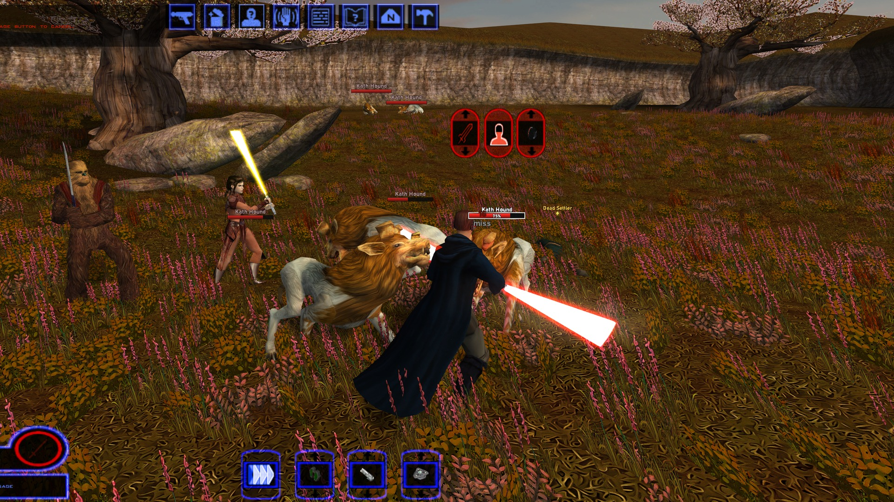
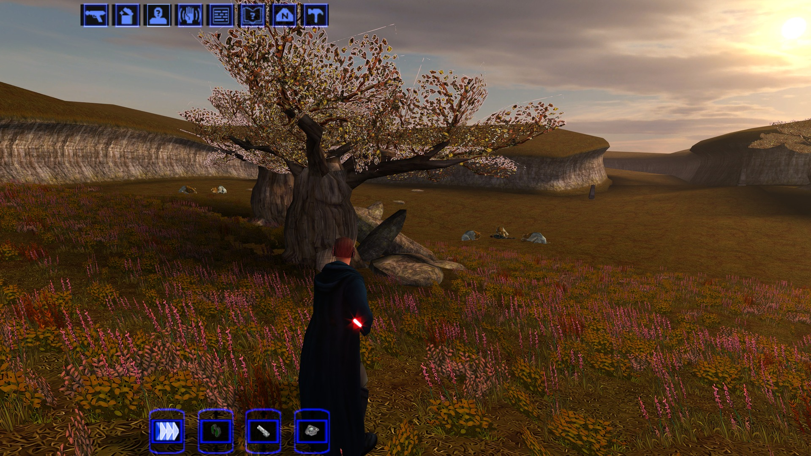
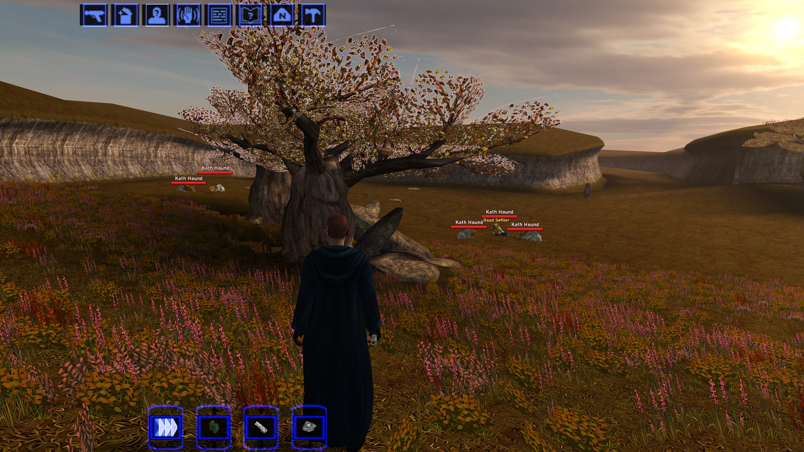

# K1 Nameplates

World of Warcraft-style nameplates for **Star Wars: Knights of the Old Republic** (PC, 2003). Every enemy you could
click gets its own name and health plate, and containers, remains, loot and usable objects get always-visible labels.

KOTOR's own overhead bar shows one creature at a time (the one under the cursor or your target), flickers away
constantly and is hard to click. This mod replaces it with a plate per creature:

- red hostile plates whenever the game draws the enemy (on screen, not culled behind walls) within 60 m; neutral
  (yellow) and friendly (green) plates on hover/target
- a framed, larger target plate with health in percent; other plates fade while you have a target
- a damage chip on hits, distance scaling, stacking instead of overlap
- click a plate to select/attack, exactly like clicking the model
- object labels: gold + sparkle for loot, grey "[empty]" once looted, cyan for terminals/workbenches; scenery and
  script markers are filtered out
- only while the HUD is up (never in dialogs, menus, cutscenes); F6 toggles

| Before | After |
|---|---|
|  |  |
|  |  |

**Download:** [Deadly Stream](https://deadlystream.com/files/file/3162-k1-nameplates/) | [Nexus Mods](https://www.nexusmods.com/kotor/mods/1909) | [GitHub release](https://github.com/phalladar/k1-nameplates/releases/latest)

**Install:** copy `dinput8.dll` and `nameplates.ini` next to `swkotor.exe`. Nothing in the exe, Override or saves
changes; delete the two files to uninstall. Works on Steam (stock or Editable Executable) and should work on GOG
(same 1.03 code, untested), at any resolution, with or without UniWS / High Resolution Menus.

## How it works

`dinput8.dll` is a proxy: swkotor.exe imports `DirectInput8Create` from it, which is forwarded to the system DLL.
The proxy patches three sites in memory and draws with OpenGL inside the game's HUD pass:

| Site | Hook | Purpose |
|---|---|---|
| 0x68b6a7 | call `CSWGuiPanel::Draw` in `CSWGuiMainInterface::Draw` | draw plates under the HUD, only while the HUD is drawn |
| 0x68b6b3 | call `CSWGuiTargetActionMenu::Draw` | hide the engine's own name/health bar for plated objects |
| 0x6222f0 | entry of `CClientExoAppInternal::HandleMouseOver` | a cursor over a plate counts as a cursor over its creature |

Every hook checks the original bytes first and is skipped on a mismatch. The stock Steam exe is SteamStub-packed (its
code is encrypted until the stub runs), so the hooks install on the game's first `DirectInput8Create` call instead of
in `DllMain`. [docs/TECHNICAL.md](docs/TECHNICAL.md) lists the engine structures used, for anyone building something
similar.

## Building

Needs [zig](https://ziglang.org) on PATH (built with 0.16) and Python 3.

```
python build.py            # build/dinput8.dll + dist/K1-Nameplates-<version>.zip
python build.py --dll-only
```

`mod/` holds what ships next to the DLL (`nameplates.ini`, `README.txt`).

## Credits

Engine addresses and struct offsets come from Lane Dibello's
[KOTOR Patch Manager](https://github.com/LaneDibello/Kotor-Patch-Manager) address database (MIT) and his KOTOR 1
reverse engineering thread on Deadly Stream.

MIT licensed.
